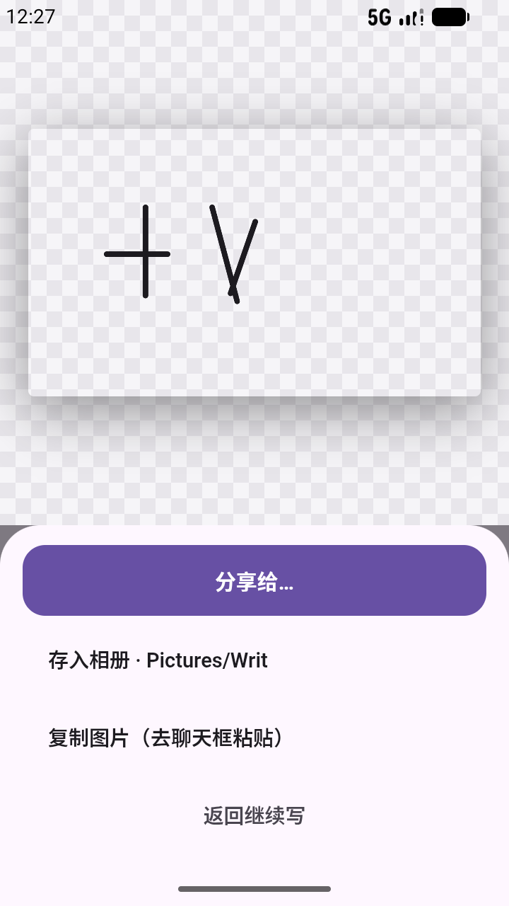

# Writ

> O, learn to read what silent love hath writ.
> —— Shakespeare, Sonnet 23

**写字，不识字。** Writ 把你手写的每一个字、每一幅画当图形切片，按顺序流式排版成一张
上下同宽、透明底的矩形 PNG——写完直接分享/存相册/复制粘贴发出去。见字如面。



- **不识别**：没有候选、没有纠错，墨迹即内容
- **自动换行**：一行写满自动折行；「空格」「换行」可手动控制
- **基线锚定**：「，」这类标点按基线对位，排出来像人写的，不像稿纸印的
- **透明底**：棋盘格/浅色/深色三种预览底，PNG 带 alpha 直接贴进聊天
- **笔色随心**：墨黑/雪白/紫罗兰/朱砂/松绿/靛蓝/赭黄/绯红 + 自定义取色，笔宽可调
- **手写笔优化**：Stylus 压力变宽，手指恒宽

## 出口

| 出口 | 去处 |
|---|---|
| 分享给… | 系统分享面板 → 微信 / QQ / 任意应用 |
| 存入相册 | `Pictures/Writ/`（Android 10+ 走 MediaStore，免权限） |
| 复制图片 | 剪贴板 content URI，聊天框长按粘贴 |

## 架构

原生壳（Java，`MainActivity` + `WritHost` JS 桥）+ WebView 零构建 web 层
（`assets/web/`：纯 HTML/CSS/JS，无 ES modules / fetch / CDN，chrome://inspect 可挂调）。
画布、裁边、排版、导出全在 web 侧；原生只管三件 PNG 出口。

UI/UX 沿用 [Mobile-Design](https://github.com/Offblink/Mobile-Design) 的
Material 3 Expressive（`tokens.css` 原样拷入），工程模式沿用
[Spore-Mobile](https://github.com/Offblink/Spore-Mobile) 的 WebView 壳。

## 构建

```bash
./gradlew assembleDebug          # 产物 app/build/outputs/apk/debug/
adb install -r app/build/outputs/apk/debug/app-debug.apk
```

要求：JDK 17+、Android SDK（compileSdk 37 / minSdk 26）、Gradle 9.5（wrapper 自带）。

## 项目结构

```
Writ/
├── DESIGN.md                     # 设计定稿（问题/决定/算法/风险）
├── app/src/main/
│   ├── java/org/offblink/writ/
│   │   ├── MainActivity.java     # WebView 壳（边到边 + console→logcat）
│   │   └── WritHost.java         # JS 桥：savePng / sharePng / copyPng
│   ├── assets/web/
│   │   ├── index.html / writ.css # M3 皮
│   │   ├── tokens.css            # Mobile-Design 设计 token（原样）
│   │   ├── engine.js             # 排版引擎（纯数学，可独立测试）
│   │   ├── pen.js                # 书写格（Pointer Events + 压力）
│   │   └── app.js                # 装配 / 导出 / 飞行动效
│   └── res/                      # 主题 / FileProvider / 自适应图标
└── gradle/                       # 9.5.0 wrapper + version catalog
```

## License

[MIT](LICENSE)
